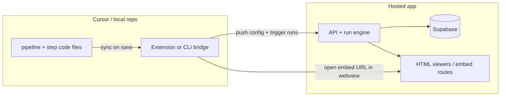

You already have most of the hard part: a hosted run engine (Vercel + Supabase) and rich HTML renderers (`json-viewer.html?embed`, doc viewer with quote spans, logging compare mode). The question is really **where editing lives** vs **where visualization lives**. The answer is: edit in Cursor as files, render on the hosted app, connect them with a thin bridge.

## The model that works

Think of it as three layers:



**Cursor owns:** structure definitions, pipeline config, custom TypeScript/Python steps, git history, LSP/diagnostics.

**Hosted app owns:** document storage, inference runs, caching, billing, and all the HTML visualization you’ve already built.

That split keeps hosting intact while making the day-to-day feel like working in a repo.

---

## 1. Represent the project as files in the repo

This is the biggest lever for “native IDE feel.” Instead of the hosted UI being the only place you edit pipeline logic, mirror it locally:

```
my-project/
  pipeline.json          # step graph, I/O wiring
  structures/
    rules.zod.ts         # or .py / JSON schema
  steps/
    extract-rules.ts     # custom functions
  samples/
    legal.pdf
    company.docx
```

On save, a bridge (extension or small CLI) pushes changes to your hosted project via API. The hosted DB remains source of truth for **runs and docs**, but the repo becomes source of truth for **config and code**.

Benefits:
- Real syntax highlighting, jump-to-definition, git blame, PR review of pipeline changes
- Cursor rules/skills can teach the agent your pipeline conventions
- “Diff” in git = config diff; “Diff” in HTML = run output diff (two different things, both useful)

---

## 2. Reuse your existing embed pattern for IDE panels

You already have the right primitive in `JsonViewerEmbed`: an iframe loading `/json-viewer.html?embed` and feeding data via `postMessage`. Extend that idea to the whole visualization surface:

| Surface | Hosted route (conceptual) | IDE usage |
|---|---|---|
| Step output | `/embed/run/{id}/step/{moduleId}` | Webview panel after run |
| JSON structure | existing `json-viewer.html?embed` | Same |
| Doc + quote highlight | `/embed/doc/{id}?start=&end=` | Side panel when clicking a quote |
| Run compare | extract from logging `compare_logs` | `/embed/compare?a=&b=&step=` |

A Cursor/VS Code extension would:
1. Trigger a run (or “run from step N”) against the hosted API
2. Poll until done (you already have progress tokens)
3. Open a **Webview Panel** pointing at the embed URL, or load the iframe HTML locally and postMessage JSON fetched from the API

That gives you the rich tree/table/json views in-editor without reimplementing them in Electron.

For document diffs (legal eval, compliance checks), the hosted side should render **semantic HTML diff** (highlighted spans, rule-by-rule pass/fail), not raw JSON diff. Your doc viewer’s offset/quote resolution is already aimed at that.

---

## 3. Bridge options (pick one, they stack)

**A. VS Code / Cursor extension (most native UX)**  
- Tree: projects → runs → steps  
- Commands: “Sync pipeline”, “Run”, “Run from step”, “Compare with last run”  
- CodeLens on `steps/*.ts`: “▶ Run this step”  
- Diagnostics: call your existing `computeInvalid` pipeline validation and surface errors as squiggles  
- Webview: hosted embed URLs with a short-lived auth token  

**B. MCP server (best for agent-driven workflow)**  
Expose tools like `list_runs`, `start_run`, `get_step_output`, `compare_runs`. Cursor’s agent can then trigger runs and open the hosted compare page. Less polished than an extension for humans clicking around, but very good if you mostly work via Composer.

**C. Thin CLI + Simple Browser (fastest to prototype)**  
A `pipeline sync && pipeline run --watch` CLI that prints a URL when done. You open it in Cursor’s Simple Browser beside your editor. No extension to maintain, but clunkier.

I'd start with **C to validate the workflow**, then **A** once the file format and embed routes feel right.

---

## 4. What “diff in HTML” should mean in practice

You likely want two diff modes, both hosted:

**Run output diff** — compare run A vs run B for the same step:
- Table view: row-level added/removed/changed (great for legal rules, SQL field mappings)
- JSON view: structural diff with your existing syntax theme
- Already partially exists in logging compare mode; it just needs a chrome-free embed route

**Source-grounded diff** — output change linked back to documents:
- Click a changed rule → doc viewer opens with quote span highlighted
- This is your moat vs a plain IDE diff; keep it in HTML, not in a text diff widget

**Config diff** — pipeline/step code changes:
- That’s git in Cursor (native already)
- Optionally show “this code change caused these output changes” by auto-running before/after on a pinned sample doc set

---

## 5. Auth and security for embeds

Hosted embed routes need:
- Short-lived JWT scoped to `run:{id}` or `project:{id}`
- `postMessage` origin allowlist (extension webview origin + your app origin)
- No full session cookie in iframes if you can avoid it

The extension holds the API key / Supabase session; the webview only gets narrow tokens.

---

## 6. A concrete daily workflow

1. Open repo in Cursor; `.env` has project ID + API token  
2. Edit `steps/map-fields.ts`, save → CLI/extension syncs to hosted project  
3. `Cmd+Shift+Enter` → hosted run with sample docs from `samples/`  
4. Output webview opens with table view (your json-viewer default)  
5. “Compare with previous run” → side-by-side embed compare  
6. Click a changed cell → doc panel jumps to cited passage  
7. Commit pipeline change; hosted runs stay in Supabase for logging/billing  

You never run the inference engine locally; you only run a sync/run client.

---

## 7. What not to do

- **Don’t port the viewers to React in the extension** — you’ll maintain two UIs. Host the HTML, embed it.  
- **Don’t make the repo the only source of truth for runs/docs** — git is bad at PDFs, cache keys, and billing.  
- **Don’t try to rebuild inference in Cursor** — keep Vercel/worker tier as-is (your TODO already sketches this cleanly).

---

## Suggested sequencing

1. Define the on-disk project format (pipeline + structures + steps)  
2. Add a `POST /api/projects/:id/sync` that accepts that format  
3. Add embed routes for run output, compare, and doc highlight (minimal chrome, token auth)  
4. Ship a tiny CLI that syncs, runs, and prints embed URLs  
5. Wrap in a Cursor extension once the loop feels good  

That gets you coding in Cursor, seeing rich HTML diffs, and keeping everything hosted — with incremental work rather than a rewrite.

If you want to go deeper on one slice (file format design, embed API shape, or extension vs MCP tradeoffs), say which part matters most.