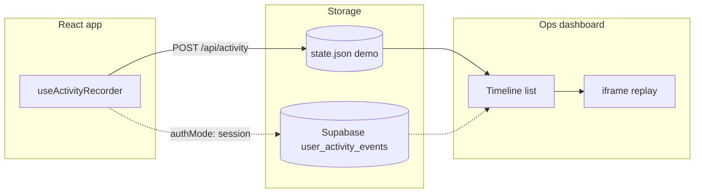

# App & track remote

Prototype for **recording what users click and type**, storing a timeline, and **replaying their session** in an iframe. The reusable pieces live in `shared/`; everything else is a minimal demo stack.

Use
https://rrweb.com/ 
Instead.

## What each folder does

| Folder | Role | Scales to production? |
|--------|------|----------------------|
| **`shared/`** | `useActivityRecorder`, `replayActivityEvents`, DOM helpers | **Yes** — copy into `combined_full_stack` |
| **`application_react/`** | Tiny signed-in app that exercises the recorder | Demo only |
| **`recreate_application_activity/`** | Ops dashboard: user picker, timeline, iframe replay | UI pattern to port; not wired to Supabase yet |
| **`server/`** | Cookie auth + JSON-file storage + Vite proxy | **No** — local dev only |



## Run locally

`npm run dev:all` starts **three processes** and shuts them all down on Ctrl+C:

1. **API router** (`server/`, port **5180**) — auth, activity ingest, timeline APIs; proxies `/app` and `/dashboard` to Vite
2. **Demo app** (`application_react/`, port **5173**, served at `/app/`)
3. **Ops dashboard** (`recreate_application_activity/`, port **5174**, served at `/dashboard/`)

One-time install from this folder:

```bash
npm install
npm install --prefix application_react
npm install --prefix recreate_application_activity
```

Then:

```bash
npm run dev:all
```

Open **http://localhost:5180** (single entry point). You can also hit the Vite ports directly during debugging.

### Run pieces separately

```bash
npm run dev                          # API only — :5180
npm run dev --prefix application_react       # demo app — :5173/app/
npm run dev --prefix recreate_application_activity  # dashboard — :5174/dashboard/
```

## How recording works

`useActivityRecorder` attaches capture listeners and batches events every few seconds:

- **Clicks** on `button`, `a[href]`, `[role='button']`
- **Typing** in inputs and textareas (password fields skipped)
- **Select** changes
- **Tab / view changes** via `activeWindow`
- **Client errors** and unhandled promise rejections

Each event stores `selector` and `data-testid` when present — required for reliable replay.

```tsx
import { useActivityRecorder } from "../shared/activity_recorder";

useActivityRecorder({
  userId: session?.userId ?? null,
  postUrl: "/api/activity",
  authMode: "demo", // or "session" in combined_full_stack
  activeWindow: currentTabName,
  projectId: currentProjectId,
});
```

Add `data-testid` on interactive elements. Use `data-no-track` to opt out.

## How replay works

The dashboard loads the app in an iframe with `?replay=1` (recording disabled). It drives replay via `postMessage` so React state updates match the recorded timeline — not just DOM clicks. The demo app listens for `REPLAY_EVENT` messages and applies each step.

Replay only works when the **live markup matches** what was recorded (same components, stable `data-testid`s).

## Relationship to `combined_full_stack`

**Yes, the `shared/` modules are designed for it.** `combined_full_stack` already has the production backend; this prototype exercises the client + ops UI in isolation.

| Piece | `app_and_track_remote` | `combined_full_stack` |
|-------|------------------------|----------------------|
| Activity ingest | `POST /api/activity` → `state.json` | `POST /api/activity` → Supabase `user_activity_events` |
| Auth | Demo cookie (`track_session`) | Supabase session |
| Client recorder | `shared/useActivityRecorder` (selector + testId) | `components/activity-tracker.tsx` (lighter — no replay metadata yet) |
| Server-side events | — | `recordActivityEvent` on runs, project edits, etc. |
| Billing timeline | — | `billing_flow_ledger` + markup migrations |
| Ops dashboard | `recreate_application_activity/` | Not built yet (spec: dashboard section) |

### Wiring into production

1. Copy `shared/` (or symlink) into `combined_full_stack` — especially `dom_utils.ts` for replay selectors.
2. Replace or upgrade `ActivityTracker` with `useActivityRecorder` so clicks/inputs include `selector` and `testId`.
3. Use session auth when posting:

```tsx
useActivityRecorder({
  userId: user?.id ?? null,
  postUrl: "/api/activity",
  authMode: "session",
  activeWindow,
  projectId: project?.id,
});
```

4. Port the dashboard UI and add admin API routes that read `user_activity_events` and `billing_flow_ledger` (the JSON server's `/api/users` and `/api/timeline` have no production equivalent yet).
5. Drop `server/` entirely in production — Next.js + Supabase replace it.

Event categories in `shared/activity_types.ts` match the Supabase `user_activity_events` check constraint. `sign_in` / `sign_out` are demo-only (local server).

## Privacy

Early-user UI telemetry is called out in the `combined_full_stack` privacy policy. Disclose recording in-product if you enable this for real users.
