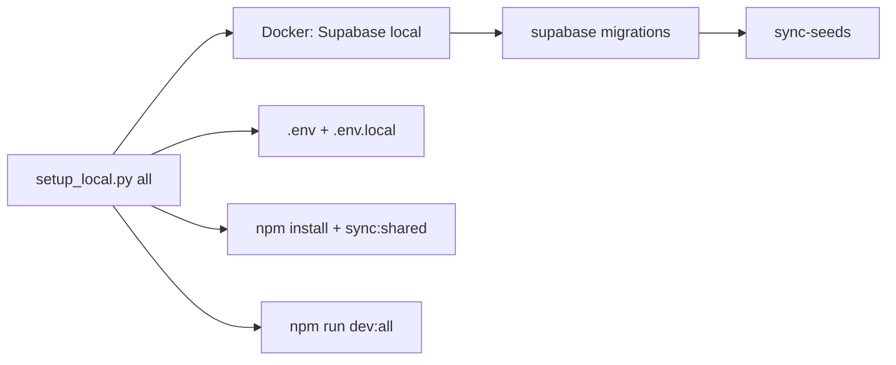

# Local hosting with Supabase

Automated setup lives in **`scripts/setup_local.py`** (stdlib Python only — no extra packages).

## One command

Prerequisites: **Docker running**, **Node.js 20+**, **Python 3**.

```bash
# 1) Add your OpenRouter key (required for the main app)
export OPENROUTER_API_KEY="sk-or-..."

# 2) Full local stack — Supabase, migrations, seeds, env files
python3 scripts/setup_local.py all

# 3) Start Next.js apps (app + landing + dashboard)
python3 scripts/setup_local.py dev
```

Or combine setup + dev in one step:

```bash
export OPENROUTER_API_KEY="sk-or-..."
python3 scripts/setup_local.py all --start-dev
```

## What it does

| Step | Command | Action |
|------|---------|--------|
| Prerequisites | `check` | Docker, Node, npm, Supabase CLI (`npx supabase` fallback) |
| Environment | `env` | Copy `.env.template` → `.env`, generate dashboard/proxy secrets |
| Database | `supabase` | `supabase start` + migrations from `combined_full_stack/supabase/` |
| Dependencies | `deps` | `npm install` (all apps) + `sync:shared` |
| Seed data | `seeds` | Create local test user, run `npm run sync-seeds` |
| Apps | `dev` | `npm run dev:all` |

`all` runs: `check` → `env` → `deps` → `supabase` → `seeds` → optional OpenRouter check.

## Service URLs

| Service | URL |
|---------|-----|
| App | http://localhost:3000 |
| Landing page | http://localhost:4000 |
| Ops dashboard | http://localhost:5050 |
| Supabase API | http://127.0.0.1:54321 |
| Supabase Studio | http://127.0.0.1:54323 |
| Email (Inbucket) | http://127.0.0.1:54324 |

## Test account

Created automatically by `seeds` / `all`:

- Email: `dev-spine-ai-dev-testing-account@local.dev`
- Password: `local-dev-password-3950`

Testing emails must contain `spine-ai-dev-testing-account` (see root `README.md`).

## Subcommands

```bash
python3 scripts/setup_local.py check      # prerequisites only
python3 scripts/setup_local.py env        # .env bootstrap
python3 scripts/setup_local.py supabase   # start Supabase
python3 scripts/setup_local.py supabase --reset   # start + db reset
python3 scripts/setup_local.py deps       # npm install
python3 scripts/setup_local.py seeds      # test user + example projects
python3 scripts/setup_local.py dev        # start all Next.js apps
python3 scripts/setup_local.py stop       # stop Supabase
python3 scripts/setup_local.py reset      # db reset + re-seed
```

## Environment files

| File | Purpose |
|------|---------|
| `.env` | Repo-wide secrets (Supabase keys filled from `supabase status`) |
| `combined_full_stack/.env.local` | `RATE_LIMIT_BACKEND=memory` for local dev without Redis |

Required for the main app: `OPENROUTER_API_KEY` in `.env`.

Optional: Stripe keys (billing disabled by default via `NEXT_PUBLIC_STRIPE_ENABLED=false`).

## Architecture



Supabase config: `combined_full_stack/supabase/config.toml`  
Migrations: `combined_full_stack/supabase/migrations/` (includes baseline `projects` / `docs` / `runs` tables)

## Troubleshooting

**Docker not running** — start Docker Desktop or `dockerd`, then rerun.

**`OPENROUTER_API_KEY missing`** — export the key or add it to `.env`, then `python3 scripts/setup_local.py dev`.

**Supabase CLI missing** — the script uses `npx supabase` automatically.

**Clean database** — `python3 scripts/setup_local.py reset`

**Stop Supabase** — `python3 scripts/setup_local.py stop`

## Remote Supabase (production)

Local setup does not replace hosted Supabase on Vercel. To push migrations to the linked remote project:

```bash
cd combined_full_stack
# Set SUPABASE_DB_PASSWORD in .env first
npm run db:push
```
